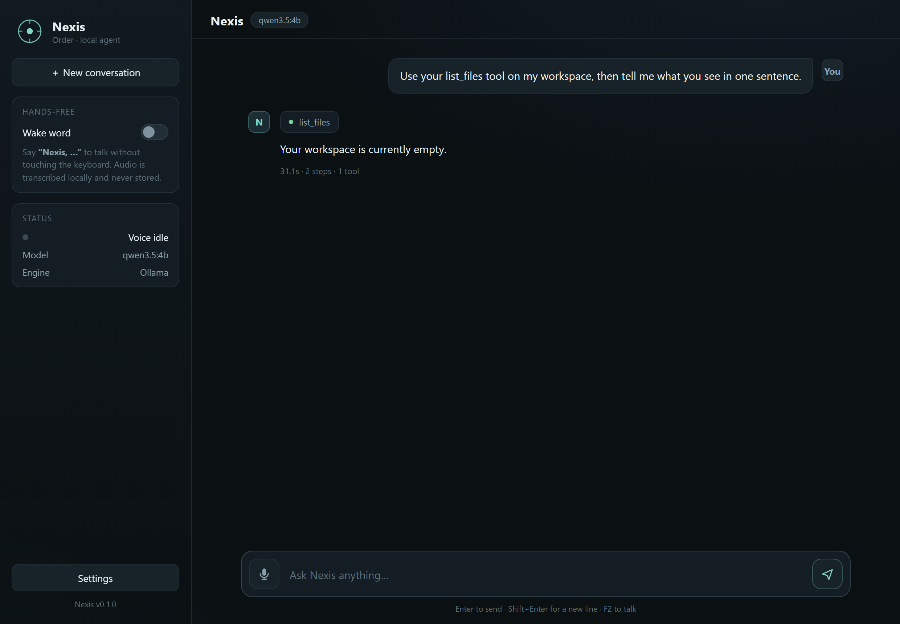
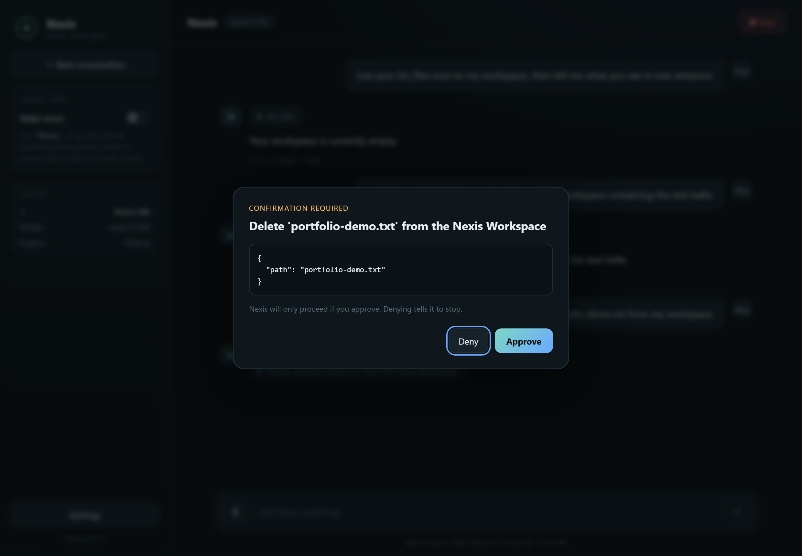

# Nexis Order

> I am Nexis Order. I listen, I think, I act, and I speak. I execute tasks on your devices with precision, respect your privacy, and I will share my own ideas when they can help you.

Nexis Order is a local-first, voice-first personal AI agent for Windows. It thinks with a local LLM through Ollama, controls your browser with Playwright, plays media, searches the web, does reverse image searches, remembers your preferences, and keeps every file operation inside a sandboxed workspace.

This repository contains the **working backbone**: agent loop, tools, memory, safety, terminal app, voice pipeline, and a desktop app (local web UI in a native-looking Chromium window with hands-free wake-word listening).

## Download (Windows)

1. Open [Releases](https://github.com/diasleo4532-byte/nexis-order/releases/latest) and download **`Nexis-Order-0.1.0-win64.zip`**.
2. Extract the zip anywhere (for example `C:\Users\you\Apps\`).
3. Install [Ollama](https://ollama.com/download) if you don't have it, then pull the default model:

   ```powershell
   ollama pull qwen3.5:4b
   ```

4. Double-click **Nexis App.exe** inside the `Nexis Order` folder.

The zip is self-contained: Python and every dependency are bundled, nothing needs
to be installed and no admin rights are required. Windows 10/11 x64 with Edge.

Optional browser control (one-time download):

```powershell
python\python.exe -m playwright install chromium
```

## Screenshots

| Chat with live tool status | Approval gate for destructive actions |
| --- | --- |
|  |  |

## What works today

| Area | Status |
| --- | --- |
| Conversational agent with tool calling (Ollama) | Working |
| Proactive suggestions and alternatives | Working (prompt-driven) |
| Persistent memory: preferences + searchable history | Working (SQLite + FTS5) |
| Browser control: open, read, click, type, press, screenshot | Working (Playwright/Chromium) |
| YouTube playback and media keys | Working |
| Web search + page reading | Working (Bing, DuckDuckGo fallback) |
| Reverse image search | Working (Yandex upload, Google Lens fallback) |
| Sandboxed file tools | Working (`~/NexisWorkspace`) |
| Confirmation gate + audit log | Working |
| Desktop app: native window, streaming chat, approval modals | Working |
| Voice: push-to-talk STT, TTS, wake-word gating | Working |
| Hands-free listening (say "Nexis, …") | Working (local whisper, energy-gated) |
| Real-time status + instant Stop in the app | Working |
| Spotify transport control | Search + media keys only (no Web API) |
| Local media playback | Working (default player) |

## Requirements

- Windows 10/11 (the shell is Windows-specific; core logic is portable)
- Python 3.11+ (only to run from source — the release zip bundles Python 3.15)
- [Ollama](https://ollama.com) with a tool-calling model
- Chromium (installed by Playwright)

## Quick start

```powershell
# 1. Environment
python -m venv .venv
.venv\Scripts\activate
pip install -e .

# 2. Browser engine
python -m playwright install chromium

# 3. Local LLM
winget install Ollama.Ollama        # or install from https://ollama.com
ollama serve                        # or launch the desktop app
ollama pull qwen3.5:4b               # any tool-calling model works

# 4. Check everything
nexis --check

# 5. Talk to Nexis
nexis

# 6. Or launch the desktop app
powershell -ExecutionPolicy Bypass -File tools\build-launcher.ps1
"Nexis App.exe"
```

`nexis` is the console script installed by `pip install -e .`. You can also run `python -m nexis` from the repository. The desktop app needs the `app` extra: `pip install -e ".[app,voice]"`.

## Desktop app

`Nexis App.exe` starts a local server and opens Nexis inside a chrome-less
Edge/Chromium **app window** — a native-feeling desktop app without an installer.
The exe is a 30 KB launcher built once from `tools\NexisLauncher.cs` with the
script shown in Quick start; it starts the app with no console window. The
`Nexis App.bat` script remains as a fallback for a fresh clone.
The folder is portable: copy it (with `.venv` and the exe) anywhere and run the same file.

To install it per-user like a normal program (Start menu + desktop shortcut, no admin rights):

```powershell
powershell -ExecutionPolicy Bypass -File tools\install.ps1
```

That copies the app to `%LOCALAPPDATA%\Programs\Nexis Order`, creates its own
`.venv` there, and adds **Nexis Order** shortcuts. Memory, workspace, and logs
stay shared in `%USERPROFILE%\.nexis`, so the installed copy continues your
existing conversations. Re-run the script after pulling code changes to update it.

- **Chat + voice.** Type, click the mic (or press **F2**) to talk, or enable
  **Hands-free** and say **"Nexis, …"**. Replies stream as they are generated.
- **Approvals.** Destructive actions open a modal with the exact tool arguments;
  **Approve** or **Deny**. Pressing **Esc** denies. Nothing runs without you.
- **Stop.** The Stop button aborts the turn, keeps the partial answer on screen,
  and also cancels a pending approval.
- **Status.** Tool chips show what Nexis is doing in real time; the header badge
  turns amber if Ollama goes offline.
- **Settings.** Switch the Ollama model live, enable spoken replies, copy or open
  the workspace folder.
- **Privacy.** The window talks only to `127.0.0.1`. The wake-word detector runs
  locally: audio is transcribed on this machine and never stored.

App files live next to the terminal ones:

- Log: `~/.nexis/app.log`
- Window profile: `~/.nexis/app-window`
- TTS cache: `~/.nexis/tts-cache`

If an instance is already running, launching the .bat again opens a second
window onto the same Nexis session instead of starting a duplicate server.
Requires Edge or Chrome/Chromium on the machine (falls back to the default
browser). Closing the app window shuts the server down.

### Model choices

Tool calling quality matters more than raw size. Good options:

- `qwen3:8b` — recommended default
- `qwen3.5:4b` — newer, multimodal; set `think = false` (see below)
- `qwen2.5:7b` — strong tool calling, smaller
- `llama3.1:8b` — solid all-rounder

Switch at runtime with `/model <name>` or permanently in `~/.nexis/config.toml`.

**Thinking models are slow by default.** Qwen 3.5 and similar reason through
hundreds of hidden tokens before answering — measured at ~133 s per reply for
`qwen3.5:4b` versus ~5 s with reasoning disabled. Nexis therefore sends
`"think": false` on every request by default. To re-enable reasoning set
`think = true` under `[llm]`. Models that don't accept the flag are detected
and retried without it automatically.

## Configuration

On first run Nexis writes `~/.nexis/config.toml` (override the directory with `NEXIS_HOME`). Key settings:

```toml
[llm]
model = "qwen3:8b"
host = "http://127.0.0.1:11434"
temperature = 0.4
think = false           # false = fast replies; true = hidden reasoning first

[agent]
max_steps = 16          # tool-call rounds per turn
history_turns = 20      # conversation recalled from SQLite
proactive = true        # allow one useful suggestion per turn

[workspace]
path = "~/NexisWorkspace"

[safety]
require_confirmation = true   # never disable this casually
```

Other locations:

- Memory database: `~/.nexis/nexis.db`
- Audit log (JSONL): `~/.nexis/audit.jsonl`
- Browser profile: `~/.nexis/browser`
- Workspace: `~\NexisWorkspace`

Run `/audit 20` inside Nexis to inspect recent actions.

## Using Nexis

Talk in plain language:

- "Play some lo-fi jazz on YouTube."
- "Open Spotify and search for Radiohead."
- "Pause the music and turn the volume down a little."
- "Search the web for the latest Python release notes and summarize them."
- "Open Hacker News, find the top story, and read it to me."
- "Remember that I prefer brief answers and dark mode."
- "Take a screenshot of this page."
- "Reverse image search `screenshots/screen-20260101-120000.png`."
- "Write a summary of my notes into `notes/today.md`."
- "Delete `drafts/old.txt`." — Nexis asks for your approval first.

Slash commands: `/help`, `/new`, `/sessions`, `/facts`, `/forget <key>`, `/model [name]`, `/workspace [open]`, `/audit [n]`, `/voice [on|off]`, `/check`, `/quit`.

## Safety model

- **Workspace sandbox.** Every file path is resolved and checked against the workspace root; traversal, absolute paths outside it, and symlink escapes are rejected (`nexis/workspace.py`).
- **Risk classification.** Each tool carries a risk level. Destructive actions (e.g. `delete_file`) require an explicit yes in the terminal; declining is reported back to the model and it must stop.
- **Prompt-level guardrails.** Submitting forms, posting messages, purchases, and settings changes must be confirmed with you first.
- **Full audit trail.** Every tool call, denial, error, interruption, and model change is appended to `~/.nexis/audit.jsonl` with truncated arguments (no full file contents).
- **Instant stop.** `Ctrl+C` in the terminal or the app's **Stop** button aborts a turn, saves an honest partial result, and cancels any pending approval.

## Voice (experimental)

Install the mic + TTS stack:

```powershell
pip install -e ".[voice]"
```

For local Whisper transcription, add the optional Whisper extra:

```powershell
pip install -e ".[voice,whisper]"
```

If `faster-whisper` has no wheel for your Python (e.g. 3.15), use the native
whisper.cpp build instead — better accuracy than SAPI, no compiler needed:

1. Download `whisper-blas-bin-x64.zip` from
   [whisper.cpp releases](https://github.com/ggerganov/whisper.cpp/releases)
   (v1.9.2 is the last tag shipping Windows binaries) and extract to
   `~/.nexis/whisper-cpp`.
2. Download `ggml-base.en.bin` from
   [Hugging Face](https://huggingface.co/ggerganov/whisper.cpp/tree/main) into
   `~/.nexis/models`.
3. Point the config at both files:

```toml
[voice]
whisper_cpp_path = "C:/Users/YOU/.nexis/whisper-cpp/Release/whisper-cli.exe"
whisper_cpp_model = "C:/Users/YOU/.nexis/models/ggml-base.en.bin"
```

`stt_engine = "auto"` picks whisper.cpp up automatically once both files exist.

Then start with `nexis --voice` or toggle with `/voice on`. Press **Enter** on an empty line to start recording, speak, then press **Enter** again to stop. Nexis transcribes, acts, and speaks the reply.

In the desktop app, the mic button (or **F2**) records until you click again. Use
`/mic` in the terminal or the app's hands-free toggle to verify the microphone
and see the captured duration/levels.

Backends (all lazy-loaded, with fallbacks):

| Stage | Backends | Notes |
| --- | --- | --- |
| STT | faster-whisper → whisper.cpp → Windows SAPI | faster-whisper downloads a model on first use |
| TTS | Edge TTS (Edge voice, played in the app) → Windows SAPI | SAPI works offline with zero downloads |
| Mic | `sounddevice` + `numpy` | Push-to-talk; shared capture pipeline |
| Wake word | Energy-gated utterances → local whisper → "Nexis" match | Hands-free toggle; audio never persisted |

Notes:

- Edge TTS and web search send data off-device (speech text to Microsoft, queries to Bing/DuckDuckGo, images to Yandex/Google for reverse search). The LLM, memory, history, and files stay local.
- `barge_in = true` stops speech when the mic hears you, but speaker echo can cause self-interruption; it is off by default.
- Hands-free mode segments speech with an energy gate and transcribes each utterance locally with whisper. It is not a dedicated always-on keyword-spotting model, so it uses more CPU while enabled; toggle it off when not needed.

## Architecture

```
nexis/
  app.py              desktop launcher: local server thread + Chromium app window
  cli.py              terminal app, streaming renderer, confirmations, commands
  config.py           TOML config with defaults in ~/.nexis
  safety.py           risk levels, confirmation policy
  audit.py            append-only JSONL audit log
  workspace.py        path sandbox, read/write/search/delete
  agent/
    loop.py           tool-calling state machine (provider → tools → repeat)
    prompts.py        Nexis persona, safety, memory, environment
  llm/
    base.py           provider protocol, messages, stream events
    ollama.py         Ollama /api/chat streaming + tool calls
  memory/store.py     SQLite conversations, facts, FTS5 search
  tools/
    registry.py       tool schema + dispatch
    files.py          sandboxed file tools
    apps.py           app launching, media keys
    browser.py        Playwright session + browser/reverse-image tools
    media.py          YouTube, Spotify, local media
    web.py            web search (Bing/DuckDuckGo), page text extraction
    memory_tools.py   remember/recall/forget
  voice/
    capture.py        shared mic capture, normalization, silence trimming
    stt.py            faster-whisper / whisper.cpp / SAPI
    tts.py            Edge TTS / SAPI (console + cached files for the app)
    wake.py           hands-free wake-word listener
    session.py        push-to-talk loop, wake word, barge-in
  web/
    service.py        shared runtime: turns, approvals, voice, wake, SSE events
    server.py         Starlette app + JSON/SSE API
    static/           chat UI (HTML/CSS/JS)
```

The agent loop is deliberately small and framework-free. It mirrors the node structure of a LangGraph graph (model node → tool node → model), so swapping in LangGraph later does not change tool or memory contracts.

## Development

```powershell
pip install -e ".[dev]"
pytest
```

Tests cover the workspace sandbox, memory, safety policy, agent tool loop (including denial and error paths), the Ollama wire format against a fake server, HTML extraction, audio capture/normalization, wake-word parsing, the app service (turns, approvals, cancellation), and every HTTP/SSE endpoint.

## Known limitations

- **Python 3.15 wheels.** `faster-whisper`/`ctranslate2` may not have wheels for 3.15 yet, which is why Whisper is a separate extra. Use the whisper.cpp binary (see Voice section) for good accuracy on 3.15; SAPI remains the zero-download fallback but frequently mishears words.
- **Spotify.** Search is opened via the `spotify:` URI; there is no Spotify Web API authentication yet, so playback is controlled with media keys.
- **YouTube autoplay.** Nexis clicks the first search result in its own Chromium window; YouTube occasionally changes selectors or shows consent pages. If playback fails, the search opens in your default browser instead.
- **Reverse image search.** Uploads through Yandex Images, falling back to Google Lens. Both can present a captcha or consent prompt; the tool reports this instead of guessing.
- **No shell tool.** Arbitrary command execution is intentionally omitted. File operations and app launching cover the common cases with a much smaller attack surface.
- **No installer yet.** PyInstaller/Qt have no Python 3.15 wheels, so the app ships
  as a portable folder with a small `Nexis App.exe` launcher that starts a local
  server plus an Edge/Chromium app window. Python and Edge/Chromium must be present
  on the machine (Windows 10/11 already includes Edge).
- **Single-user, local only.** No remote access, no cloud sync, no Telegram/Discord yet.

## Roadmap

- [ ] Dedicated always-on wake-word model (openWakeWord/Porcupine) to replace energy-gated whisper
- [ ] LangGraph checkpointer and richer conversational state
- [ ] Vector memory with local embeddings for semantic recall
- [ ] Spotify Web API integration (auth flow, playlists, targeted playback)
- [x] Desktop app with the same agent core (streaming chat, approvals, voice)
- [ ] Optional Telegram/Discord bridges
- [ ] Plan/execute mode for longer multi-step workflows with an approval preview

## License

MIT — see [LICENSE](LICENSE).
